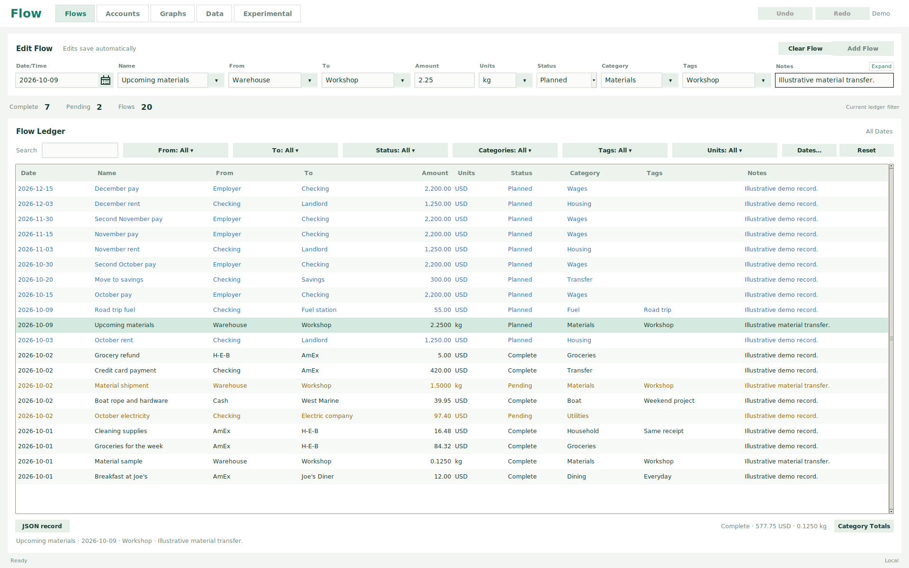
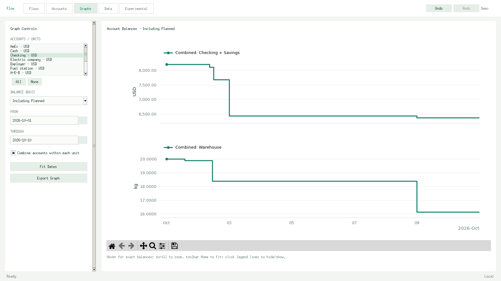

# Flow

Flow records **quantified transfers between accounts**. A flow may move money, material, energy, inventory, or any other resource you can express as a number and a unit. The desktop app keeps each account's balance separately for each unit and lets you inspect how those balances change over time.

For example, moving `0.125 kg` from Warehouse to Workshop subtracts `0.125 kg` from one balance and adds it to the other. A `USD` flow can involve the same accounts without changing either kilogram balance. Quantities use exact decimal arithmetic; units are labels, not exchange rates.



## Try it

On Ubuntu, install Python 3.10 or newer and the desktop dependencies:

```bash
sudo apt install python3-tk python3-matplotlib
./launch.sh --demo
```

The demo uses a separate database with illustrative `USD` and `kg` transfers. For your own records, run `./launch.sh`. If you use another Python installation, install `requirements.txt` into that environment and ensure its Tkinter module works.

Flow saves personal records under `~/.local/share/flowledger/flow.sqlite3` by default; `--demo` uses `demo.sqlite3`. Set `XDG_DATA_HOME` to move this directory or pass `--db /path/to/file.sqlite3` to choose a database. The app is local; it does not sync between computers. **Esc** leaves fullscreen mode.

## The model

A flow has a date/time, name, **from**, **to**, amount, units, status, category, tags, and notes. The source and destination are account names; a saved flow also has an ID for editing and import. Date-only means midnight in local time. Times can be specified to the second.

```json
{
  "date": "2026-10-03 09:15:06",
  "name": "Materials",
  "from_account": "Warehouse",
  "to_account": "Workshop",
  "amount": "0.125",
  "units": "kg",
  "status": "Complete",
  "category": "Materials",
  "tags": ["Project"],
  "notes": "Sample for the workshop"
}
```

Flow amounts can be zero or negative. Zero keeps a dated note without changing balances; a negative amount reverses the transfer's effect while preserving the entered From and To.

An account can hold multiple units. Set a separate starting balance and date/time for each account/unit pair in **Accounts**. Click a column heading to sort balances, and click again to reverse the order. An unknown starting balance remains unknown; enter `0` when zero is known. Negative balances are allowed. Resource transfers conserve quantity *within each unit*; different units are never added or converted.

**As of** sets the date/time for both displayed balance columns. It defaults to **Now**; a blank value also uses the current time. Enter a future date to inspect future flows, including pending transfers. Date-only means midnight.

| Balance basis | Included flows |
| --- | --- |
| Confirmed | Complete |
| Including Pending | Complete, Pending |
| Including Planned | Complete, Pending, Planned |

**Canceled** remains in the ledger but affects no balance or graph. You can change a flow's status as it progresses. A transfer between your own accounts moves the balance without creating or destroying the resource.

## Work with flows

- Type into the top form, then choose **Add Flow**. From, To, Units, Category, and Tags accept new values; suggestions come from saved flows. The date defaults to today; the time is optional. Unadded entries remain populated when you switch tabs.
- Click a ledger row and edit its fields above, or double-click a cell to edit in place. Completed valid changes save automatically. **Ctrl-click** toggles rows; **Shift-click**, **Shift-arrow**, and **Shift-scroll** select ranges in row lists. The top form edits the active row only.
- Flows sort by **Date/Time → From → To → Amount → Units → Status → Category → Name**. Dates start newest first; the remaining fields ascend. Click a heading to make it the primary sort, and click again to reverse that column.
- **Ctrl+C / Ctrl+V** duplicates selected flows with fresh IDs. Copies appear beside their sources when sort values match; the view follows a row moved by an edit. **Delete** removes selected flows. A batch paste or deletion is one **Ctrl+Z / Ctrl+Y** undo/redo action in the current session.
- Amounts and starting balances accept arithmetic such as `1.23 + 4.56`, `(10 - 2) * 3`, or `12 / 4`, with an optional leading `=`. Press Enter or leave the field to calculate; only the resulting number is saved. Decimal results stay exact when terminating; repeating results use at least 50 significant digits.
- Search finds account names in either From or To. Combine checkbox filters for From, To, Units, Status, Categories, and Tags; **Reset** clears the search, selections, and date limits in one undoable step. Choices disappear when their last saved reference is removed. Filters do not change saved records or balances.
- In **Graphs**, click an account/unit pair to select it, Ctrl-click to add or remove selections, and use Shift-click or Shift-arrow for ranges. Scroll over the list to browse it. Plot each pair or combine selected accounts *within the same unit*. Dates fit the selected records, and values get 10% vertical breathing room. Hover for exact values, scroll over the plot to zoom, and use **Fit Dates** after a manual range. The graph refreshes as its controls change.
- **Experimental** animates the currently filtered flows on a draggable account map. Step through timestamps, play/pause, or change speed from 0 to 5. Hover a node for its balance and a moving flow for its record details. Controls refresh automatically. Scroll to pan, Ctrl-scroll to zoom, and double-click empty space to fit the map. This tab does not write data.
- The **Data** tab imports and exports flows as CSV or JSON and offers database backup and restore. An import preview catches duplicates and conflicts before changes are saved. [Example import files](examples/README.md) show the supported fields.

To see the Python repository API, run `python3 -m examples.two_units`; it creates two independent resources in a temporary database.



## Design and verification

Flow uses Python, Tkinter, Matplotlib, and SQLite. Amounts are stored as decimal text and calculated with `Decimal`; plotted coordinates use floating point only for drawing. [The data model](docs/model.md) explains the tables, starting balance rule, and graph calculations. [`flowledger/schema.sql`](flowledger/schema.sql) contains the actual schema.

Run the complete suite on a graphical desktop with `python3 -m unittest discover -s tests`. On a headless Linux machine, install `xvfb` and run:

```bash
xvfb-run -a -s '-screen 0 1920x1200x24' python3 -m unittest discover -s tests
```

The included GitHub Actions workflow runs the same suite for pushes and pull requests. The application currently uses local timestamps on one computer; it has no unit conversion, network synchronization, or automatic recurrence.

## License

[MIT](LICENSE) © 2026 Jim Lewis.

