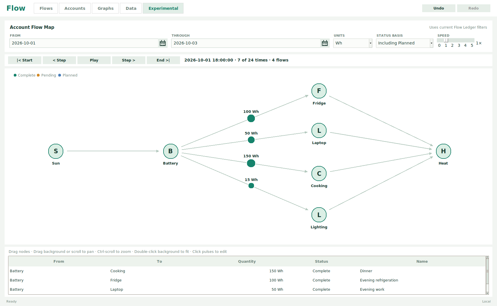

# Flow

Flow records and visualizes **transfers between accounts, in any unit**. Track money, materials, energy, inventory, or water with the same small set of fields.

Record a transfer, inspect the ledger, graph the balances, or play it through a map of accounts. Each unit stays separate: a payment in USD never changes a balance in kg.


## Run it

From the project directory on Ubuntu, with Python 3.10 or newer:

```bash
sudo apt install python3-tk python3-matplotlib
./flow --demo
```

The demo uses a separate file. Run `./flow` for your records. **Esc** leaves fullscreen; terminal Ctrl+C exits.

For a `flow` command available outside this directory:

```bash
./install.sh
flow
```

The installer checks dependencies and links `~/.local/bin/flow` to this project. It installs no packages or shell settings; keep the project folder in place. It prints PATH instructions if needed.

## One file for each dataset

```bash
flow money
flow energy
flow /path/to/travel.sqlite3
```

`flow money` opens `money.sqlite3` in the current directory, then checks `~/.local/share/flowledger`. If neither exists, it creates the file there. Omitted extensions become `.sqlite3`; explicit paths are used directly.

Running without a name keeps opening `~/.local/share/flowledger/flow.sqlite3`. `XDG_DATA_HOME` overrides the default data location, and `--db PATH` accepts an exact filename.

Completed edits save automatically. Close Flow and copy the database to move records, starting balances, history, and map layout together. CSV/JSON exports contain **flows only**; database backups preserve everything. There is no automatic sync.

## Work with the ledger

- **Add:** fill the top form; the hint lists missing fields. Date defaults to today, time is optional, and amounts accept arithmetic such as `(12 + 8) / 2`.
- **Edit:** select a row or double-click a cell. Valid edits save when you finish a field; rows stay put as you Tab across them.
- **Clear:** Clear Flow resets the form and selection. Unadded drafts survive tab switches.
- **Select:** Ctrl-click toggles rows; Shift-click or Shift-arrow selects a range. Hover a selection for totals by account, category, and unit.
- **Copy or delete:** Ctrl+C / Ctrl+V duplicates rows; Delete removes them. Ctrl+Z / Ctrl+Y undo and redo within the current session.
- **Find:** search or combine From, To, Units, Status, Categories, and Tags filters. Choices reflect saved flows; Reset clears the filters.

Zero and negative amounts are valid. Matching From and To accounts have zero net balance change. Names, categories, tags, and notes describe each transfer. [See the fields, defaults, and calculations](docs/model.md).

## Balances over time

Set a starting balance for each account/unit pair. Enter `0` for known zero; unknown balances stay unknown. **As of** in Accounts includes eligible flows through that instant.

Graphs compare accounts or combine them within a unit. They refresh automatically. Hover for exact values, scroll to zoom, and use the toolbar to pan or return home.

| Basis | Records included |
| --- | --- |
| Confirmed | Complete |
| Including Pending | Complete and Pending |
| Including Planned | Complete, Pending, and Planned |

Canceled records affect no balances or animation. Planned records are ordinary dated flows: include them to inspect projected balances.


## Experimental: follow the transfers

Accounts become nodes; transfers travel along directed paths. Larger quantities produce larger pulses. The map uses the current ledger filters, with its own date range, unit, and status basis.



Play, pause, step, or jump to either end; speed runs from 0 to 5. Hover nodes for balances and totals, or pulses for flow details. Click a pulse to edit its record.

Drag accounts into a useful arrangement. **Positions save in the dataset and return on reopening.** Pan by dragging the background or scrolling; Ctrl-scroll zooms, and double-clicking empty space fits the layout. Drag undo/redo saves the restored positions. Playback never changes flow records.

## Try a different resource

The [camp example](examples/README.md) follows three days of battery energy in **Wh** and tank water in **L**, with completed, pending, and planned transfers:

```bash
python3 -m examples.camp
./flow camp
```

It creates `camp.sqlite3` in the current directory and refuses to overwrite an existing file. In Graphs, select **Including Planned** and compare Battery / Wh with Fresh tank / L. In Experimental, choose Wh and Including Planned to explore the equipment map. Change a planned transfer to see how much energy or water would remain.

[More examples](examples/README.md) include CSV/JSON imports, actual record objects, an inspectable SQL dump, and a short Python API example using two independent units.

## Implementation and checks

Python, Tkinter, Matplotlib, and SQLite. Quantities use exact decimal arithmetic; plot and map coordinates use floating point. The [data model](docs/model.md) and [schema](flowledger/schema.sql) describe storage and balance rules. With another Python environment, install `requirements.txt` and ensure Tkinter is available.

Run the tests on a graphical desktop:

```bash
python3 -m unittest discover -s tests
```

On a headless Linux machine with `xvfb` and `xauth` installed:

```bash
xvfb-run -a -s '-screen 0 1920x1200x24' python3 -m unittest discover -s tests
```

GitHub Actions runs the suite on pushes and pull requests. Flow currently uses local wall-clock times and has no unit conversion, automatic recurrence, or mobile interface.

## License

[MIT](LICENSE) © 2026 Jim Lewis.
