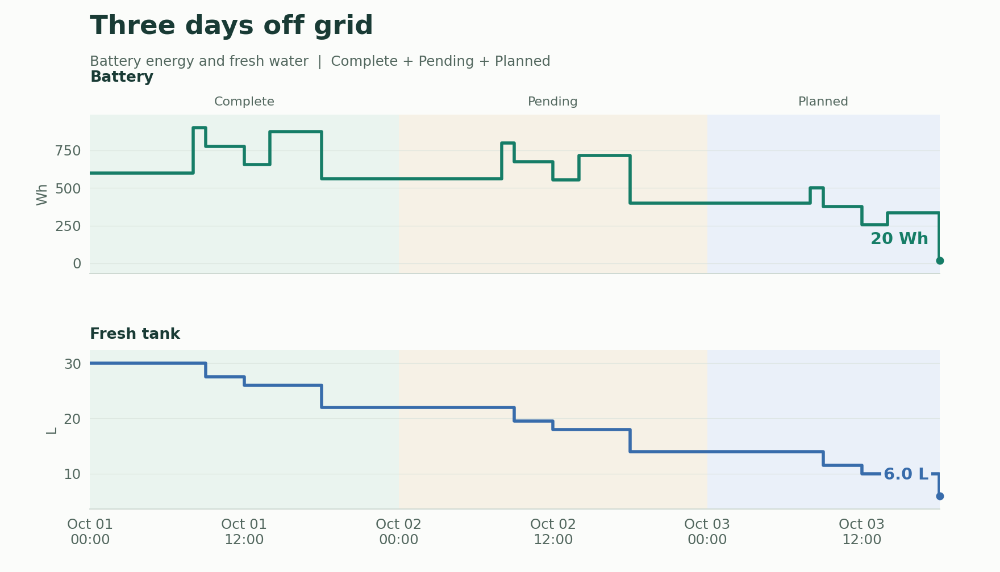

# Flow

Flow records **quantified transfers between accounts**. A flow may move money, material, energy, inventory, or any other resource you can express as a number and a unit. Each account holds a separate balance for each unit.

Inspect individual transfers in the ledger, compare balances over time, or follow resources through an animated map of accounts. Include planned flows to explore future balances.


## Try it

From the project directory on Ubuntu, with Python 3.10 or newer:

```bash
sudo apt install python3-tk python3-matplotlib
./flow --demo
```

The demo uses a separate database. Run `./flow` for your own records. **Esc** leaves fullscreen; terminal **Ctrl+C** exits.

For a `flow` command available from other directories, run `./install.sh`. It checks dependencies and links `~/.local/bin/flow` to this project. Keep the project folder in place.

## The model

Moving `0.125 kg` from Warehouse to Workshop subtracts that quantity from one balance and adds it to the other. A USD transfer can involve the same accounts without changing either kilogram balance. Units are labels, not exchange rates.

A flow records **date/time, from, to, amount, and units**, with a name, status, category, tags, and notes for context. Account names identify the endpoints; each saved flow has its own ID.

<details>
<summary>Example flow record (JSON)</summary>

```json
{
  "date": "2026-10-03 09:15:06",
  "name": "Materials",
  "from_account": "Warehouse",
  "to_account": "Workshop",
  "amount": "0.125",
  "units": "kg",
  "status": "Complete",
  "category": "Materials",
  "tags": ["Project"],
  "notes": "Sample for the workshop"
}
```

Flow assigns an ID when this record is created. Amounts are decimal strings to preserve precision.

</details>

Zero amounts can keep dated notes; negative amounts reverse the transfer's effect. Matching From and To accounts have zero net change. See the [data model](docs/model.md) for the calculation rules.

## Working with flows

Fill the top form, then choose **Add Flow**. The hint lists missing required fields. Date defaults to today; time is optional. **Clear Flow** resets the form and selection. Drafts survive tab switches.

Select a row or double-click a cell to edit. Valid changes save as you finish each field; sorting waits until you leave the row.

- **Find:** search or combine account, unit, status, category, tag, and date filters.
- **Inspect:** Ctrl-click or Shift-click selects rows; hover for account, category, and unit totals.
- **Reuse:** Ctrl+C / Ctrl+V duplicate selected flows with new IDs.
- **Correct:** Delete removes selected flows. Ctrl+Z / Ctrl+Y undo and redo during the session.

Amount and starting-balance fields accept arithmetic such as `(10 - 2) * 3`. Press Enter or leave the field to calculate.

Caret powers work in the same fields: `2^3` gives `8`, `2^-3` gives `0.125`, and `9^0.5` gives `3`. Powers come before multiplication and division; chained powers group from the right (`2^3^2 = 512`). Use parentheses to control grouping: `-2^2 = -4`, while `(-2)^2 = 4`.

## Balances and forecasts

Set a starting balance and date for each account/unit pair in **Accounts**. Enter `0` for a known zero; leave unknown balances blank. **As of** sets the date/time for calculated balances.

**Graphs** compares selected account/unit pairs or combines balances within a unit. Plots update automatically. Hover for exact values, scroll to zoom, and use the toolbar to pan or reset.

| Balance basis | Included flows |
| --- | --- |
| Confirmed | Complete |
| Including Pending | Complete and Pending |
| Including Planned | Complete, Pending, and Planned |

Canceled flows remain in the ledger but affect no balances. Forecasts use ordinary Planned flows: change a future purchase, delivery, or resource use to see its effect on what remains.


## Experimental: the account map

Accounts become nodes; flows travel between them. Direction shows where a resource moves, and pulse size represents quantity. The map uses the ledger filters plus its own date range, unit, and balance basis.


Play, pause, or step through the timeline. Hover accounts for balances and totals, or pulses for records. Click a pulse to edit its flow.

Drag accounts to arrange the map; positions are saved in the database. Drag the background or scroll to pan, Ctrl-scroll to zoom, and double-click empty space to fit. Playback does not alter records.

In the camp map, Wh follows energy from Sun through Battery and the equipment to Heat. Switch Units to L to see Fresh tank supply Drinking, Cooking, and Washing, with wash water collected in Waste tank. Cooking appears in both views, with separate balances for each resource.

The start/end buttons jump across the simulation; the speed slider runs from 0 to 5. Ledger filters let you isolate one route or category before playing it. Moving nodes changes the layout, not the transfers.

## Example: three days off grid

The [camp example](examples/README.md) starts with 600 Wh in a battery and 30 L of water. Solar input falls each day while equipment use stays constant. Including planned flows, the third evening ends with 20 Wh and 6 L remaining.

```bash
python3 -m examples.camp
./flow camp
```

This creates `camp.sqlite3` without overwriting an existing file. Select **Battery / Wh**, **Fresh tank / L**, and **Including Planned** in Graphs. Reduce a planned solar input to see when the battery would run short.

### Reading the camp balances



The battery starts at **600 Wh** and the fresh-water tank at **30 L**. Equipment uses 560 Wh and the camp uses 8 L each day. Solar adds 520, 400, then 180 Wh as the days become less productive.

| End of day | Status of that day's flows | Battery (Wh) | Fresh tank (L) |
| --- | --- | ---: | ---: |
| October 1 | Complete | 560 | 22 |
| October 2 | Pending | 400 | 14 |
| October 3 | Planned | 20 | 6 |

The picture includes all three statuses. In Graphs, **Confirmed** shows completed activity; **Including Planned** adds both pending and planned transfers to the projection.

Try changing the third day's **Morning solar input** from 100 to 60 Wh. The projected battery balance falls from 20 to **-20 Wh**, exposing a shortfall; water remains at **6 L**. Undo restores the original plan. These are editable transfers, so the same method works for deliveries, inventory, or spending.

## Your data

Each dataset is one SQLite file. Keep resources together or use separate files:

```bash
flow money
flow energy
flow /path/to/travel.sqlite3
```

`flow money` looks for `money.sqlite3` locally, then in `~/.local/share/flowledger`, creating it there if needed. Explicit paths are used directly. Without a name, Flow opens `flow.sqlite3` in that default directory.

Close Flow before copying a database to another computer. The file carries records, starting balances, audit history, and map positions. There is no automatic synchronization.

The **Data** tab offers CSV/JSON import and export, plus full database backup and restore. Imports preview duplicates and conflicts. CSV/JSON files contain flows only; [examples](examples/README.md) show the format.

## Development

Flow uses Python, Tkinter, Matplotlib, and SQLite. Quantities use decimal storage and exact arithmetic; drawing coordinates use floating point. Dates use local wall-clock time. See the [schema](flowledger/schema.sql) and [Python examples](examples/README.md).

Run the tests on a graphical desktop:

```bash
python3 -m unittest discover -s tests
```

For headless Linux, with `xvfb` and `xauth` installed:

```bash
xvfb-run -a -s '-screen 0 1920x1200x24' python3 -m unittest discover -s tests
```

GitHub Actions runs the suite on pushes and pull requests.

## License

[MIT](LICENSE) - Jim Lewis.
